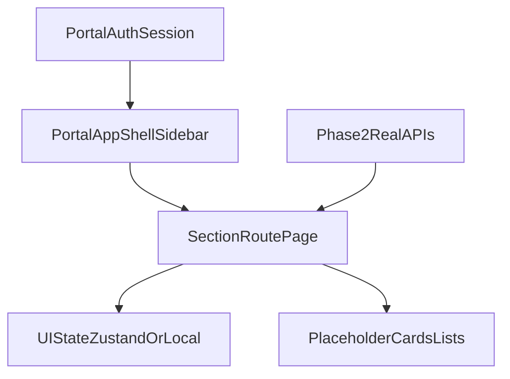

# Customer Portal UI-First Plan

## Goal

Ship a world-class, mobile-friendly customer experience first (navigation, page layouts, onboarding UX, component polish), while keeping advanced backend/data integration for phase 2.

## Confirmed Scope (from you)

- Primary navigation uses a **sidebar** so customer can move to Orders/Social/etc.
- Build **real pages with polished UI + static/placeholder content** where APIs are not ready.
- Social flow: on click Social, show onboarding notice:
  - "If you join, you will be visible to other customers of Network Service."
  - ask user to choose a nickname
  - if accepted, show social area UI (placeholder feed for now)
- Initial friends concept should show **internal users** (UI placeholder in phase 1; real mapping in phase 2).

## Existing Foundations To Reuse

- Portal shell and auth context: [`D:/our-own-website/service-mgmt-experiment/src/app/(external)/portal/page.tsx`](<D:/our-own-website/service-mgmt-experiment/src/app/(external)/portal/page.tsx>), [`D:/our-own-website/service-mgmt-experiment/src/modules/external/portal/PortalHeader.tsx`](D:/our-own-website/service-mgmt-experiment/src/modules/external/portal/PortalHeader.tsx)
- Account profile switching: [`D:/our-own-website/service-mgmt-experiment/src/modules/external/portal/PortalAccountSwitcher.tsx`](D:/our-own-website/service-mgmt-experiment/src/modules/external/portal/PortalAccountSwitcher.tsx)
- Portal tickets base (repairs): [`D:/our-own-website/service-mgmt-experiment/src/app/(external)/portal/tickets/page.tsx`](<D:/our-own-website/service-mgmt-experiment/src/app/(external)/portal/tickets/page.tsx>)
- Shop wishlist base: [`D:/our-own-website/service-mgmt-experiment/src/app/(external)/shop/wishlist/page.tsx`](<D:/our-own-website/service-mgmt-experiment/src/app/(external)/shop/wishlist/page.tsx>), [`D:/our-own-website/service-mgmt-experiment/src/store/external/shopWishlistStore.ts`](D:/our-own-website/service-mgmt-experiment/src/store/external/shopWishlistStore.ts)

## Information Architecture (UI Phase)

- Create a customer portal app shell with sidebar sections:
  - Dashboard
  - My Orders
  - My Repairs
  - Social
  - My Coupons
  - My Wallet
  - Wishlist
  - Profile Settings
- Mobile behavior:
  - Left sidebar as sheet/drawer trigger (hamburger)
  - Sticky top header + quick actions
  - Safe spacing and touch targets (Shadcn patterns)

## Phase 1 Implementation Plan

### 1) Build a dedicated portal shell + sidebar navigation

- Add a reusable portal shell component in `src/modules/external/portal/` (e.g., `PortalAppShell.tsx`).
- Wire route-aware sidebar items, active states, icons, and mobile drawer mode.
- Keep SSR pages; only interactive shell parts as client components.

### 2) Add route pages (UI complete, static/mock where needed)

- Add new external portal routes under `src/app/(external)/portal/`:
  - `orders/page.tsx` (My Orders)
  - `repairs/page.tsx` (My Repairs; can visually extend current tickets style)
  - `social/page.tsx` (onboarding + feed placeholder)
  - `coupons/page.tsx` (cards/list placeholders)
  - `wallet/page.tsx` (balance + transaction placeholders)
  - `wishlist/page.tsx` (portal view; can deep-link/reuse shop wishlist)
  - `settings/page.tsx` (profile settings hub; include existing password card)
- Rework portal home as dashboard cards linking to these sections.

### 3) Social onboarding flow UI

- Build social onboarding state UI in `social/page.tsx`:
  - onboarding notice banner/modal text you specified
  - nickname input + validation UX
  - consent CTA to continue
- After consent in UI phase:
  - show placeholder social feed and “initial friends (internal team)” list UI.
- Persist onboarding UI state client-side (Zustand/local storage) for phase 1 only.

### 4) Component-level visual polish

- Improve all section pages with consistent:
  - card density, typography hierarchy, spacing rhythm
  - empty/loading/skeleton states
  - mobile-first spacing and responsive breakpoints
  - unified CTA styles and iconography
- Reuse Shadcn primitives and existing theme tokens.

### 5) Navigation and cross-links

- Update `PortalHeader` + portal layout so sidebar experience is primary and consistent.
- Keep quick links to Shop and Tickets where useful.
- Ensure no broken paths; all sidebar entries resolve.

### 6) Phase 2 readiness (backend later, no full integration yet)

- For each new page, define data contract comments/types for future API hookup:
  - orders list DTO
  - repair timeline DTO
  - social profile/feed DTO + nickname persistence
  - coupon/wallet DTO
- Keep API calls behind mock adapters so swapping to real endpoints is straightforward.

## Data Flow (UI-first)

## Acceptance Criteria (Phase 1)

- Sidebar-based portal navigation works on desktop + mobile drawer.
- All requested sections exist with polished, mobile-friendly UI.
- Social page includes onboarding notice + nickname step before showing social UI.
- Profile settings and wishlist are discoverable in sidebar and styled consistently.
- No runtime errors; lint clean on touched files.

## Test Checklist

- Mobile viewport: sidebar drawer opens/closes, route transitions are smooth.
- Desktop: sidebar active state reflects current page.
- Social flow: first visit shows notice + nickname; continue reveals social surface.
- Dashboard cards route to every section.
- Visual consistency: spacing, headings, button sizes, empty states across pages.
